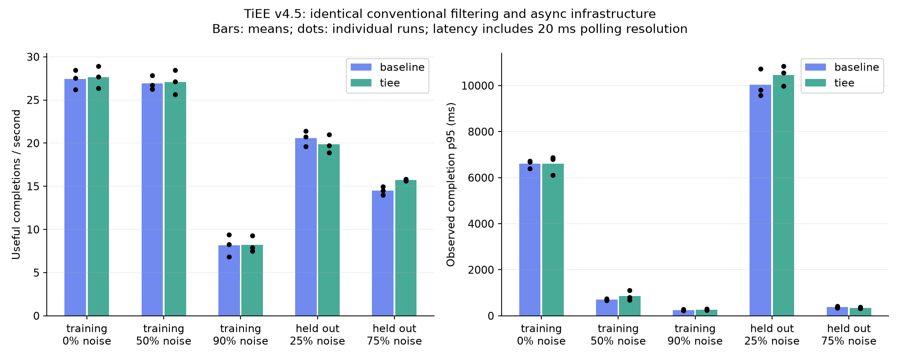
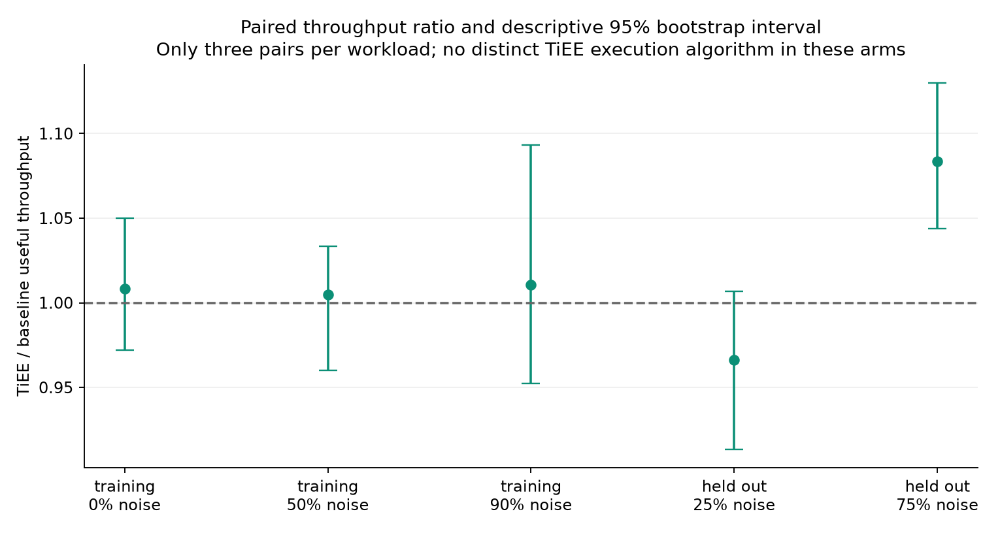
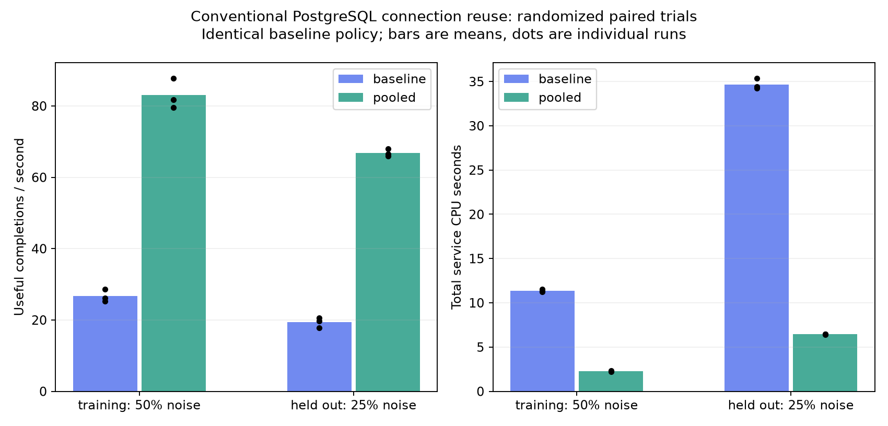

# TiEE Core v4.5 — real infrastructure, recovery and performance evidence

Status: Experimental pilot verified on the existing scaling potato Codespace. No production deployment. Report generated 2026-10-11T06:53:29.858519+00:00.

## Findings

- All 20 named real-service gates passed across the default and bounded-connection-reuse profiles; 40 final gate outcomes. Ten source contract tests also passed.
- All 30 neutral-policy comparison runs and all 12 connection-reuse experiment runs passed independent digest and event accounting checks. These measured runs submitted 19,500 source events, excluding warmups.
- No distinct TiEE performance advantage is established. Baseline and TiEE apply the same deterministic bot filter and asynchronous pipeline; TiEE eligibility is a neutral implementation, with no operational EV scoring or value scheduling.
- PostgreSQL consumed 78.6% of measured service CPU in the original comparison. Repeated connection establishment was selected as a conventional optimization target; the separate paired experiment below evaluates bounded connection reuse.
- Recorded target-event recovery durations across final gates ranged from 0.875 to 5.632 seconds, including container startup/readiness and coarse observation overhead. See raw logs for each fault and timer boundary.

## Preservation and source changes

Verified base commit: 6e12b5098699ba636cdb1112dd192da74d8f9bb3. Development branch: tiee-core-v45-validation. The original robotics-v01 worktree status was checked against its fresh preservation snapshot and remained unchanged. All 404 original regular files outside .git were also byte-identical to the fresh archive.
Original backup: /workspaces/tiee-backup-20261010T100752Z. Fresh complete repository archive and staged/unstaged patches: /workspaces/tiee-preserve-v45-20261011T061415Z. Archive readability and SHA-256 hashes are recorded in results/v45/preservation.json. Existing robotics archives and prior reports were retained.

Changes serialize concurrent schema DDL with a PostgreSQL transaction advisory lock, recreate a lost Redis consumer group without restarting the worker, retry transient group recreation failures, lock event rows before result/audit commit, and prevent broker replays from executing SQL-rejected events. Optional PG_POOL_SIZE=8 enables bounded connection reuse; the default 0 retains the original connection mode for reproduction. The pool dependency is pinned.
Singularity Gateway performs durable SQL admission; Quantum EV Logic Engine is the neutral eligible function in app/common.py; Grand Gallery is Redis Streams with AOF appendfsync=always; King’s Chamber stores event, result and audit tables in PostgreSQL. Relay reconciliation retries unresolved accepted rows. Acknowledgment to Redis follows successful result transaction commit. There is no external actuator or irreversible side effect in this workload.

## Final real-service test matrix

| Gate | Default | Pool size 8 |
|---|---|---|
| admission_contracts | PASS | PASS |
| relay_SIGKILL | PASS | PASS |
| worker_SIGKILL | PASS | PASS |
| pending_reclaim | PASS | PASS |
| redis_SIGKILL_AOF | PASS | PASS |
| postgres_SIGKILL | PASS | PASS |
| gateway_SIGKILL | PASS | PASS |
| redis_stream_and_group_loss | PASS | PASS |
| durable_202_pg_crash | PASS | PASS |
| backpressure_safe_retry | PASS | PASS |
| redis_publish_failure | PASS | PASS |
| relay_transaction_rollback_after_xadd | PASS | PASS |
| result_transaction_rollback | PASS | PASS |
| postgres_unavailable_no_false_ack | PASS | PASS |
| final_accounting_idempotent_audit | PASS | PASS |
| deterministic_AOF_without_reconciliation | PASS | PASS |
| rejected_duplicate_conflict | PASS | PASS |
| concurrent_idempotent_commits | PASS | PASS |
| cold_schema_concurrency | PASS | PASS |
| deterministic_stream_group_loss | PASS | PASS |

Crash gates use real SIGKILL on pilot containers. Pending reclaim explicitly delivers a target event to a dead Redis consumer with relay stopped, then exercises the 3,000 ms Redis pending-delivery lease through XAUTOCLAIM. The implementation has no separate SQL worker-lease subsystem. Stream/group loss deletes only the pilot stream; the deterministic regression removes an initialized group and verifies completion without worker restart. Backpressure fills a 32-event bound, checks 503 plus absence from SQL, permits duplicate retry, drains, and safely retries the same ID.
Transaction triggers force relay SQL rollback after observed XADD and result-insert rollback before acknowledgment. The concurrent idempotence regression publishes 40 duplicates, uses two worker processes and delays a selected result insert; exactly one result and one DONE audit survive. Rejected-event identity conflicts and broker replay rejection are verified. The schema regression performs 32 concurrent schema calls on a fresh SQL database.

## Failed and initially unexecuted checks

- Initial real startup failed: Gateway and worker exited with a PostgreSQL pg_type uniqueness error during concurrent CREATE TABLE. Traces are retained in startup-failure.log; the advisory-lock fix and fresh-database concurrency regression address it.
- The first harness run failed eight gate invocations before their substantive assertions because an output directory lacked parents. This was corrected; integration-initial.log preserves those harness failures.
- The first cold-schema regression failed before exercising DDL because the helper lacked /srv on its Python import path. The corrected final-default and pooled runs passed. regression.log retains the initial failure.
- The first pooled profile failed subsequent admission after PostgreSQL restart because stale sessions were handed out. Connection checkout checks and two-second acquisition/connect limits were added; pool-integration-before-check.log retains the failed attempt. The final pooled suite below is the acceptance gate.
- The inherited pre-fix recovery suite passed eight checks. Its stream-loss timing was insufficient to establish the suspected missing-group behavior; the stronger final regression is the relevant evidence.
- No unresolved failures remain among the final executed gates. Physical power-loss durability, simultaneous loss of PostgreSQL and Redis durable volumes, prolonged production load, real AI/GPU workloads, and non-neutral EV scheduling were not executed. These results do not validate those cases.

## Matched randomized comparison

Training: 400 events, 2,000 SHA-256 rounds, noise 0%, 50%, 90%. Held out: 600 events/8,000 rounds/25% noise and 450 events/4,000 rounds/75% noise. Three paired repetitions per workload; workload and arm order randomized with saved seed 451011. Seeds for held-out workloads differ from training. Each trial uses a fresh database and 30-event warmup. Input hashes excluding run-specific IDs and independent expected output sets match within pairs.
Both arms use one worker process, eight publisher threads, identical rejection criteria, schema, admission capacity, relay retry settings, Redis AOF and PostgreSQL durability, container image and shared Codespace resources. The probe container holds HTTP generation, commit observation and digest verification; it is excluded from service CPU/RAM totals.

| Workload | Arm | Useful/s mean | Completion p50 ms | p95 ms | p99 ms |
|---|---|---:|---:|---:|---:|
| training, 0% noise | baseline | 27.41 | 4122.1 | 6608.0 | 6845.2 |
| training, 0% noise | tiee | 27.65 | 4281.6 | 6601.4 | 6806.9 |
| training, 50% noise | baseline | 26.94 | 510.1 | 704.4 | 743.8 |
| training, 50% noise | tiee | 27.09 | 523.8 | 865.1 | 924.6 |
| training, 90% noise | baseline | 8.17 | 195.1 | 250.7 | 291.0 |
| training, 90% noise | tiee | 8.22 | 199.4 | 266.9 | 283.0 |
| held_out, 25% noise | baseline | 20.57 | 6361.0 | 10039.7 | 10431.8 |
| held_out, 25% noise | tiee | 19.89 | 6567.2 | 10462.0 | 10849.3 |
| held_out, 75% noise | baseline | 14.50 | 254.4 | 384.0 | 475.1 |
| held_out, 75% noise | tiee | 15.71 | 242.5 | 342.9 | 371.9 |

| Workload | TiEE/baseline useful-throughput ratio | Descriptive 95% interval |
|---|---:|---|
| training, 0% noise | 1.008 | [0.972, 1.050] |
| training, 50% noise | 1.005 | [0.960, 1.033] |
| training, 90% noise | 1.011 | [0.952, 1.093] |
| held_out, 25% noise | 0.966 | [0.913, 1.007] |
| held_out, 75% noise | 1.084 | [1.044, 1.130] |

Geometric paired bootstrap uses 10,000 resamples and seed 451012. Only three pairs per workload make these intervals descriptive and sensitive to environmental noise; no multiplicity correction or production inference is claimed. Small observed differences between behaviorally identical arms do not establish a TiEE-specific causal gain.

## CPU, RAM, queues and storage

| Workload | Arm | Service CPU s | Sampled working-set MiB | SQL pending peak | Stream peak | SQL tables KiB growth | WAL KiB growth | AOF KiB growth |
|---|---|---:|---:|---:|---:|---:|---:|---:|
| training, 0% | baseline | 21.43 | 233.1 | 208.3 | 468.7 | 418.7 | 865.2 | 357.3 |
| training, 0% | tiee | 21.76 | 226.5 | 207.3 | 467.0 | 418.7 | 795.5 | 356.0 |
| training, 50% | baseline | 12.16 | 226.9 | 19.7 | 18.3 | 304.0 | 460.8 | 88.0 |
| training, 50% | tiee | 11.97 | 224.6 | 22.0 | 20.7 | 301.3 | 412.0 | 88.0 |
| training, 90% | baseline | 8.61 | 171.2 | 3.0 | 2.7 | 200.0 | 292.2 | 21.3 |
| training, 90% | tiee | 8.60 | 167.5 | 3.3 | 3.0 | 200.0 | 286.2 | 22.7 |
| held_out, 25% | baseline | 33.73 | 269.5 | 241.3 | 746.7 | 517.3 | 1133.4 | 538.7 |
| held_out, 25% | tiee | 34.89 | 269.4 | 242.0 | 782.7 | 530.7 | 1084.2 | 549.3 |
| held_out, 75% | baseline | 11.74 | 270.8 | 5.3 | 4.3 | 277.3 | 407.6 | 56.0 |
| held_out, 75% | tiee | 11.38 | 271.2 | 5.0 | 4.7 | 280.0 | 381.4 | 56.0 |

All values above are means of per-run measurements. Cgroup memory endpoints are separate raw fields, not the Docker working-set metric. Sampled peaks are lower bounds on unobserved peaks. SQL size includes indexes; WAL and AOF deltas share persistent pilot storage and include background maintenance/allocation effects. CPU counter windows extend through client verification and metric collection, so background service work during that tail is included. Raw CSV/JSON includes HTTP errors/status counts, admission p50/p95/p99, all completion observations, queue and Docker stats samples, per-service CPU, and storage snapshots.

## Conventional connection-reuse experiment

The baseline policy is held constant. Three randomized pairs compare pool size 0 versus maximum 8 connections per application process on a training 400-event/2,000-round/50%-noise workload and a held-out 600-event/8,000-round/25%-noise workload. Randomization seed 451013; new input seeds. Worker resources and durability match. The recovery suite was rerun with pooling before measuring this candidate.

| Workload | Original useful/s | Pooled useful/s | Pooled/original ratio [95% descriptive CI] | CPU ratio | P95 ratio |
|---|---:|---:|---|---:|---:|
| training | 26.66 | 83.01 | 3.116 [2.858, 3.357] | 0.200 | 1.150 |
| held_out | 19.37 | 66.80 | 3.454 [3.230, 3.830] | 0.186 | 0.335 |

The training queue peak increased from 16.3 to 58.3 events, while mean p95 increased from 651.8 to 750.7 ms. Held-out mean p95 decreased from 10477.6 to 3493.1 ms, while queue peak increased from 235.3 to 304.7. Faster admission can increase backlog even when useful throughput improves.

Connection reuse is a conventional database optimization available equally to TiEE and the control. It provides no evidence for toroidal, quantum or EV-specific superiority. Additional candidates include shorter publication transactions and batched worker connections, but they were not implemented or credited as measured improvements here.

## Next engineering gate

Compare a calibrated, non-neutral EV policy against an equally optimized conventional filter and scheduler on a real target workload. Match output obligations and measure false rejection, scheduling cost, and end-to-end utility before crediting a TiEE-specific gain.

## Reproduction and evidence

See REPRODUCE_V4_5.md for credential generation, isolated Compose commands, all suites, randomized runs and figure generation. Exact plotting dependencies are recorded in results/v45/chart-requirements.txt. Environment, base commit, archive hashes, image digests and limits are recorded in JSON. The Codespace advertised two cores/eight GB; resources are shared, with no per-service CPU reservation.
[Reproduction commands](REPRODUCE_V4_5.md), [comparison CSV](results/v45/trials.csv), [comparison raw JSON](results/v45/randomized-benchmark.json), [optimization CSV](results/v45/optimization/trials.csv), [optimization raw JSON](results/v45/optimization/randomized-benchmark.json), and [artifact hashes](results/v45/artifact-sha256.json). Archived SQL trial databases and Docker volumes are retained. No secrets are included in committed artifacts.

