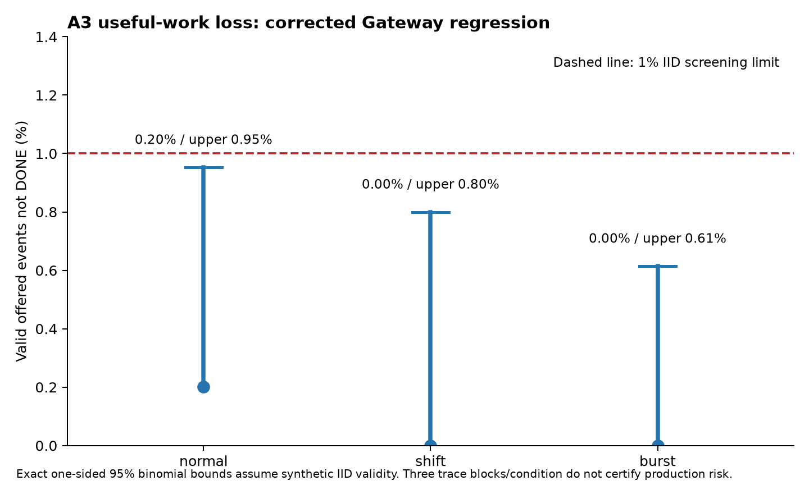
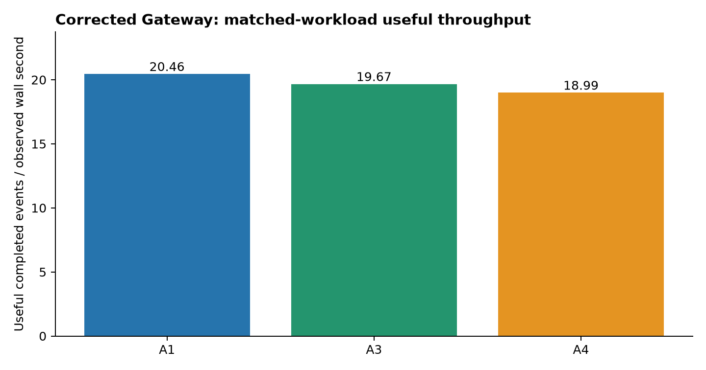
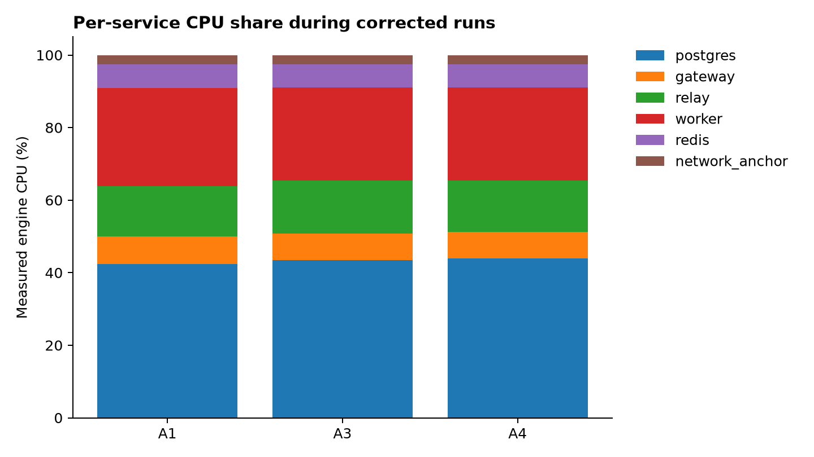

# TiEE v4.7 corrected Gateway regression

Completed 27 matched runs and accounted for 6,480 offered events. Overall operational gate: **PASSED**. Synthetic IID useful-work screen: **PASSED**. Performance superiority remains **NOT ESTABLISHED**.

## Scope and evidence

Base a7abc0e uses the corrected Gateway accept backlog of 128. The original pilot used backlog 5 and recorded three A4 connection resets; its FAILED result remains preserved in results/v47. Controlled post-pilot bursts previously reproduced five resets before the fix and passed 96 requests at each pool setting after the fix. The existing 21 real integration checks and 2,000 policy parity examples were not rerun in this round; their prior evidence remains separately identified.

This diagnostic repeats the exact 27 prior jobs, workload seeds and randomized arm order. All arms share private Redis/PostgreSQL, durability, two workers, pool size 8, 12-second deadlines and 13-second drain allowance on the existing 2-core Codespace. A1 is conventional asynchronous deadline ordering; A4 is the conventional matched filtering/asynchronous control; A3 is TiEE with the same observable policy and scheduler. No production deployment or model tuning occurred.

## Passed, failed and unexecuted

- Executed: all 27 corrected-source matched runs, independent result digests, SQL terminal markers and complete offered-event accounting. Gates are reported below; a completed run is not automatically a passed operational gate.
- Preserved failure: the original pre-fix pilot has three HTTP connection resets.
- Previously passed, not rerun: 21 integration checks and 2,000 policy parity examples.
- Unexecuted: independent fresh held-out powered superiority confirmation, production clustered-loss certification, physical power/host-loss/disk-corruption tests and database optimization experiments.

## Useful-work loss

| Condition | Valid offered | Valid rejected | Valid not DONE | Loss % | Exact upper 95% % | IID screen |
|---|---:|---:|---:|---:|---:|---|
| normal | 496 | 1 | 1 | 0.202 | 0.953 | PASSED |
| shift | 373 | 0 | 0 | 0.000 | 0.800 | PASSED |
| burst | 486 | 0 | 0 | 0.000 | 0.615 | PASSED |

Bounds are exact one-sided Clopper-Pearson 95% under synthetic IID validity. All-cause loss includes rejection, expiry, refusal and unfinished useful work. Three trace blocks per condition cannot certify production clustered risk.

## Measured execution

| Arm | Useful/s mean | Net utility/CPU mean | CPU s/run | HTTP errors | Poll errors | Drain failures | Missing timing | HELD |
|---|---:|---:|---:|---:|---:|---:|---:|---:|
| A1 | 20.455 | 4.224 | 10.114 | 0 | 0 | 0 | 0 | 0 |
| A3 | 19.673 | 4.911 | 10.565 | 0 | 0 | 0 | 0 | 0 |
| A4 | 18.995 | 4.717 | 10.556 | 0 | 0 | 0 | 0 | 0 |

## Latency and overhead

| Arm | Offered terminal p50/p95/p99 ms | ACK p50/p95/p99 ms | RAM peak MiB | Queue peak | Table / WAL / AOF mean bytes |
|---|---|---|---:|---:|---|
| A1 | 1855.1 / 5865.8 / 6663.6 | 398.0 / 599.2 / 712.9 | 331.9 | 143 | 1514610 / 2127452 / 137444 |
| A3 | 1933.3 / 6138.8 / 6890.5 | 333.9 / 612.8 / 735.7 | 331.1 | 154 | 2025244 / 2661240 / 133803 |
| A4 | 1906.7 / 6460.2 / 7483.2 | 346.4 / 670.6 / 909.3 | 330.2 | 152 | 2024334 / 2663326 / 133803 |

Terminal latency is the first observed committed database terminal state, including final committed snapshot observations; it never uses an HTTP ACK fallback. SQL terminal_at is written before commit, not an exact fsync-completion clock. CPU brackets include sampler and post-drain verification/storage work; probe CPU is separately recorded and excluded from engine CPU, though host contention remains. Component profiles and all dispatch/scoring/admission percentiles are in analysis.json.

## Statistical uncertainty

| Paired contrast | Mean net utility/CPU difference | Bonferroni 97.5% interval | Paired blocks |
|---|---:|---|---:|
| A3 minus A4 | 0.194 | [-0.082, 0.554] | 9 |
| A3 minus A1 | 0.688 | [0.476, 0.957] | 9 |

20,000 independently stratified paired trace bootstrap draws; two contrasts, exploratory inference. These reused traces and nine paired blocks are not powered independent confirmation. Any advantage over A1 can reflect conventional filtering. A3/A4 policy parity prevents attributing filtering efficiency to a distinct TiEE mechanism.

## Bottlenecks and next experiment

| Arm | PostgreSQL CPU share % | Admission lock p95 ms | Prewrite p95 ms | Scoring p95 ms |
|---|---:|---:|---:|---:|
| A1 | 42.44 | 162.6 | 571.5 | 2.19 |
| A3 | 43.46 | 165.1 | 589.1 | 1.68 |
| A4 | 43.89 | 162.0 | 648.1 | 1.83 |

Profile PostgreSQL statement time and admission advisory-lock contention before changing behavior. Evaluate a bounded SQL/relay polling or batching improvement on a separate branch, with equal durability and resources and randomized paired baseline/candidate order. Re-run durable receipts, capacity races, duplicate/conflict handling, atomic result rollback and crash recovery for any database change. Freeze fresh held-out seeds and power calculation before confirmation; retain all failures. No database optimization was performed in this round.

## Reproduction and artifacts

See REPRODUCE_V4_7_CORRECTED.md. Frozen plan and hashes, lossless runs.jsonl.gz, runs.csv, terminal_ledger.csv, resource_samples.csv, first SQL admission profiles, analysis.json and standalone PNG/PDF/SVG charts are under results/v47/corrected. Original reports, raw failures, robotics work and backups are preserved. Private test services are stopped after collection; volumes are retained.
