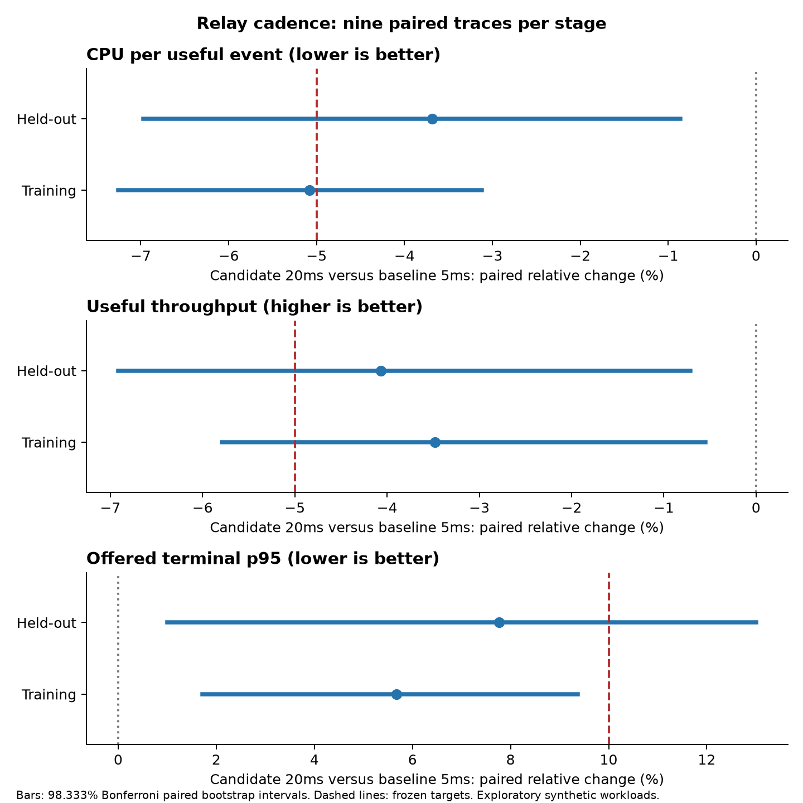
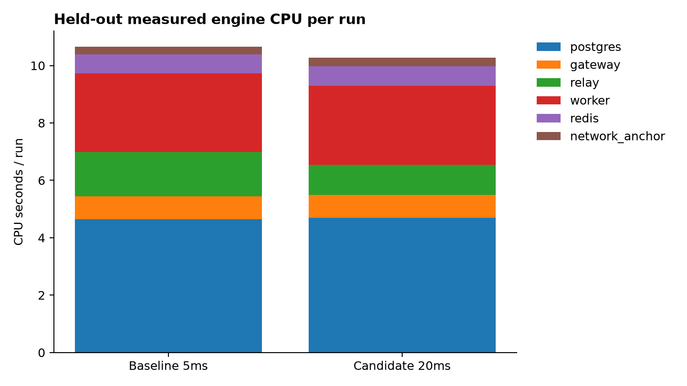

# TiEE Core v4.8 database coordination experiment

Completed **36 randomized matched runs**, including **18 fresh held-out runs**, with **8,640 offered events accounted for**. All **18 real candidate integration checks passed** across pooling disabled/enabled; polling validation passed 11 input cases plus the unchanged 5ms default. Frozen optimization adoption gate: **FAILED**. Distinct TiEE superiority remains **NOT ESTABLISHED**.

## Engineering decision

retain default 5ms; candidate failed frozen adoption gate. The experimental 20ms setting is available on this development branch; existing v4.7 runtime source and the default 5ms cadence are preserved. No production deployment occurred.

## What the profile found

Normalized PostgreSQL statement counters and 421 service wait snapshots identified advisory-lock waiting in Gateway admission, row-lock/transaction waits in workers, and repeated relay scans. Cumulative SQL execution time includes waiting and is not CPU time. Normalized advisory-lock statements merge lock IDs, so service wait snapshots are needed for attribution. Observer sampling was enabled only for this diagnostic profile; it was OFF during all matched performance runs. PostgreSQL statement instrumentation and I/O timing were identical in baseline and candidate.

| Leading normalized statement (abbreviated) | Calls | Total execution ms | Mean ms |
|---|---:|---:|---:|
| SELECT pg_advisory_xact_lock(73422) | 1449 | 3714.14 | 2.563 |
| SELECT payload,state,generation,deadline FROM events WHERE id=$1 FOR UPDATE | 260 | 851.95 | 3.277 |
| SELECT application_name,state,wait_event_type,wait_event,count(*) FROM pg_stat_activity WHERE datnam | 421 | 290.08 | 0.689 |
| SELECT id,state FROM events WHERE id LIKE $1 AND state IN ($2,$3,$4,$5) | 135 | 169.66 | 1.257 |
| INSERT INTO decision_history(id,decision) VALUES($1,$2) | 676 | 155.85 | 0.231 |
| SELECT state,count(*) FROM events WHERE id LIKE $1 GROUP BY state | 195 | 144.13 | 0.739 |
| SELECT id FROM events WHERE state='PENDING' ORDER BY CASE WHEN created_at < now()-interval '0.5 seco | 1109 | 89.56 | 0.081 |
| UPDATE events SET state=$1,decision=$2,deferrals=deferrals+$4,next_at=LEAST(deadline,now()+interval  | 412 | 88.24 | 0.214 |

Wait samples are occupancy counts, not independent requests or exact duration estimates. The raw samples preserve service, state, wait type and event, without logging credentials.

## Controlled change and frozen method

One change was tested: relay polling every 20ms versus the 5ms baseline. Both call the exact same v47 relay_once transaction logic and use the same image, admission policy/model, two workers, pool size 8, Redis AOF appendfsync always and durable PostgreSQL commits. Worker leases, generation fencing, retries, idempotent results, publication/database rollback and terminal audit markers are unchanged.

Before collection, the plan froze 18 training and 18 held-out jobs, each stage with nine paired traces across normal/shift/burst. Workloads contain 240 events/run, rates 40 normal and 80 otherwise, 12s deadlines, 13s drain allowance and 24 warmup events. Paired payload IDs, hidden validity labels and trace hashes match exactly; every run uses a fresh database. Candidate cadence was selected before any held-out collection and was not tuned. All trials are retained.

## Paired effects and statistical uncertainty

| Stage | Endpoint | Mean change % | Bonferroni 98.333% interval % |
|---|---|---:|---|
| training | cpu_per_useful | -5.08 | [-7.26, -3.12] |
| training | useful_throughput | -3.48 | [-5.79, -0.55] |
| training | offered_p95_ms | 5.67 | [1.72, 9.36] |
| heldout | cpu_per_useful | -3.69 | [-6.97, -0.86] |
| heldout | useful_throughput | -4.06 | [-6.91, -0.72] |
| heldout | offered_p95_ms | 7.77 | [1.00, 13.00] |

20,000 condition-stratified paired bootstrap draws, nine paired traces per stage. Three endpoint intervals use Bonferroni familywise adjustment. CPU/useful target is at least 5% mean reduction in both stages; useful throughput must not fall more than 5%; offered-terminal p95 must not rise more than 10%; no additional useful event loss or operational failure is allowed. Held-out interval guardrails are additionally required. These small synthetic workloads do not establish production risk or powered TiEE superiority.

## Actual execution metrics

| Stage | Variant | Useful/s | CPU s/run | Valid not DONE | HTTP/poll errors | Drain failures | Missing timing/HELD |
|---|---|---:|---:|---:|---|---:|---|
| training | baseline | 18.074 | 10.553 | 1 / 1253 | 0 / 0 | 0 | 0 / 0 |
| training | candidate | 17.484 | 10.026 | 1 / 1253 | 0 / 0 | 0 | 0 / 0 |
| heldout | baseline | 18.224 | 10.665 | 0 / 1274 | 0 / 0 | 0 | 0 / 0 |
| heldout | candidate | 17.501 | 10.269 | 0 / 1274 | 0 / 0 | 0 | 0 / 0 |

## Latency, resources and storage

| Stage | Variant | Offered p50/p95/p99 ms | ACK p50/p95/p99 ms | RAM peak MiB | Queue peak | Table/WAL/AOF bytes per run |
|---|---|---|---|---:|---:|---|
| training | baseline | 1802.6 / 6207.7 / 7325.2 | 362.6 / 606.4 / 829.0 | 320.3 | 142 | 1933312 / 2713777 / 134258 |
| training | candidate | 1932.7 / 6318.4 / 7356.2 | 310.3 / 568.1 / 680.4 | 318.0 | 158 | 1927851 / 2754667 / 133348 |
| heldout | baseline | 1808.1 / 6187.4 / 7029.5 | 368.3 / 597.4 / 697.3 | 347.7 | 147 | 2013412 / 2588933 / 133348 |
| heldout | candidate | 1991.3 / 6669.9 / 7633.6 | 292.2 / 597.3 / 873.6 | 346.1 | 156 | 1987015 / 2593653 / 133348 |

Terminal latency is observed committed SQL state, never an HTTP-ACK fallback. terminal_at is written before commit, not an exact fsync-completion time. Engine CPU brackets include sampling/storage/verification operations; probe CPU is excluded but still shares host resources. Raw component endpoints and samples preserve this measurement scope.

## Passed, failed and unexecuted

- PASSED: all 18 final real Redis/PostgreSQL candidate integration checks, 11 polling input cases and unchanged default validation. Test details include measured recovery elapsed times and service/crash evidence.
- EXECUTED: all 36 matched trials with raw event accounting; optimization gates are separately reported, including failed guardrails.
- FAILED setup/export attempts retained: missing local Docker image tag; PostgreSQL profiling export column mismatch; malformed generated Compose value that blocked 17 checks in the first test attempt (one atomic result check passed). These attempts are not silently counted as passed recovery tests. Corrected attempts and recovered diagnostic data are retained separately.
- UNEXECUTED: physical power/host loss and disk-corruption recovery; production workload certification; powered distinct-TiEE superiority; alternative batching/index/locking optimizations.

## Recovery checks and elapsed time

| Pool size | Check | Status | Total check seconds |
|---:|---|---|---:|
| 0 | receipt_crash | PASSED | 23.630 |
| 0 | bounded_defer | PASSED | 8.108 |
| 0 | destructive_expiry | PASSED | 9.516 |
| 0 | rollback_fence | PASSED | 12.635 |
| 0 | recovery | PASSED | 29.539 |
| 0 | capacity_auth | PASSED | 10.168 |
| 0 | recorder | PASSED | 11.424 |
| 0 | reject_and_scorer | PASSED | 9.458 |
| 0 | audit_marker_rollback | PASSED | 11.694 |
| 8 | receipt_crash | PASSED | 18.833 |
| 8 | bounded_defer | PASSED | 7.367 |
| 8 | destructive_expiry | PASSED | 9.820 |
| 8 | rollback_fence | PASSED | 12.446 |
| 8 | recovery | PASSED | 26.280 |
| 8 | capacity_auth | PASSED | 9.794 |
| 8 | recorder | PASSED | 11.305 |
| 8 | reject_and_scorer | PASSED | 8.937 |
| 8 | audit_marker_rollback | PASSED | 10.868 |

Total check time includes setup and assertions; individual recovery durations remain in tests/integration.jsonl details and must not be interpreted as universal recovery guarantees.

## Next measured step

Retain the frozen result even if the candidate fails. Profile admission critical-section hold time and transaction boundaries next, then evaluate one safe improvement without removing capacity serialization or weakening durable 202 receipts. A distinct TiEE scheduling mechanism requires a separate falsifiable implementation and an equally optimized conventional control.

## Reproduction and preservation

See REPRODUCE_V4_8.md and V4_8_ENGINEERING_SPECIFICATION.md. Source hashes, plan, raw lossless JSON, CSV ledgers/resources, SQL profiles, failed attempts, test details and PNG/PDF/SVG figures are under results/v48. Original robotics workspace, v4.6 and v4.7 source/reports/results/backups are preserved. Only private tiee47pilot services were used and are stopped with volumes retained.
